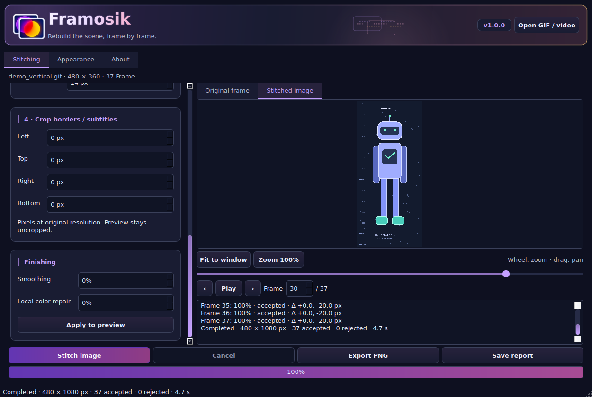
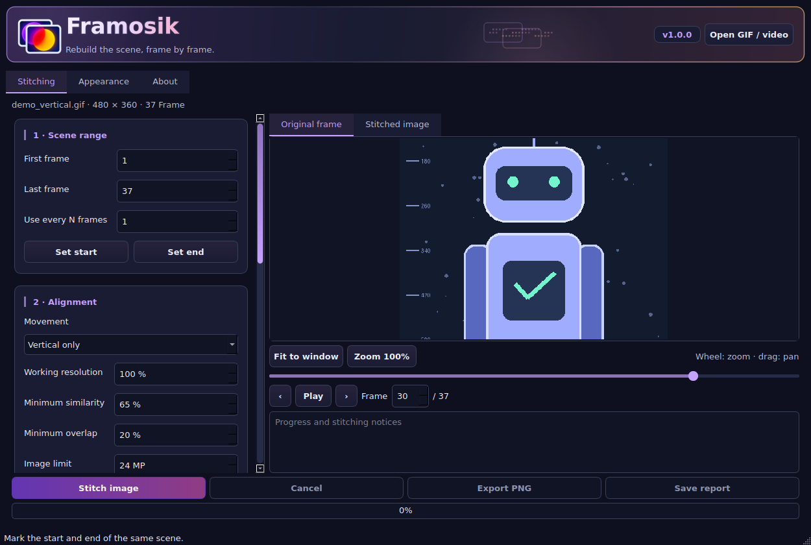
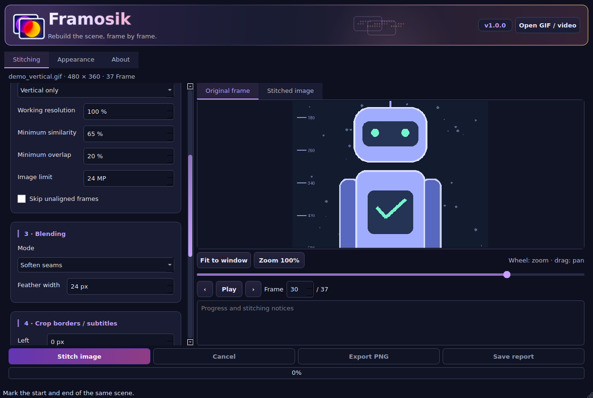
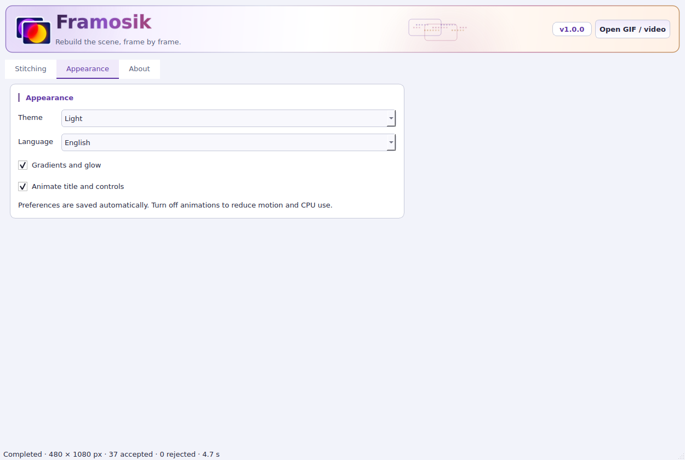

# Framosik

**Transforme um movimento de câmera em uma imagem inteira.** O Framosik encontra detalhes em comum entre os quadros de um GIF ou vídeo, posiciona cada quadro e amplia a imagem com as áreas que a câmera revelou. Uma cena que vai dos pés à cabeça de um personagem pode virar um retrato de corpo inteiro. A montagem roda localmente no computador.

[Baixar a versão 1.0.0](https://github.com/cleitinhodev/framosik/releases/tag/v1.0.0) · [Baixar o tutorial detalhado em 10 idiomas (HTML)](https://github.com/cleitinhodev/framosik/raw/refs/heads/main/docs/Framosik-Tutorial.html) · [Site](https://www.bugzinho.com/) · [Apoiar o projeto](https://www.bugzinho.com/donate)



## Baixar e abrir

| Sistema | Pacote | Como abrir |
| --- | --- | --- |
| Windows x64 | [Framosik-1.0.0-Windows-x64.zip](https://github.com/cleitinhodev/framosik/releases/download/v1.0.0/Framosik-1.0.0-Windows-x64.zip) | Extraia o ZIP inteiro e abra `Framosik.exe` dentro da pasta `Framosik`. |
| Linux x86_64 | [Framosik-1.0.0-Linux-x86_64.tar.gz](https://github.com/cleitinhodev/framosik/releases/download/v1.0.0/Framosik-1.0.0-Linux-x86_64.tar.gz) | Extraia o arquivo e abra `Framosik`, ou execute `./Framosik` na pasta extraída. Base de compatibilidade: Ubuntu 22.04 e glibc 2.35. |

Os dois pacotes incluem o aplicativo, as dependências, o exemplo e a edição do tutorial publicada com o executável. O guia avulso acima traz uma referência pesquisável de 41 controles e três experimentos guiados. Mantenha a pasta `_internal` ao lado do executável. Há instruções de dependências gráficas, execução e verificação do pacote no [guia Linux](https://github.com/cleitinhodev/framosik/blob/main/LINUX.md).

## Sua primeira montagem

1. Clique em **Open GIF / video (Abrir GIF / vídeo)** ou pressione `Ctrl+O`. Abra `examples/demo_vertical.gif`, incluído nos dois pacotes. O primeiro quadro mostra os pés do robô.
2. Na aba **Original frame (Frame original)**, navegue com a régua, as setas ou **Play (Reproduzir)**. Para o exemplo, use os quadros **1 a 37** e passo **1**. Em um vídeo maior, use **Set start (Marcar início)** e **Set end (Marcar fim)** para isolar uma única cena. Os dois extremos são incluídos.
3. Em **Movement (Movimento)**, escolha **Vertical only (Somente vertical)**. Mantenha a resolução em 100% e o modo **Preserve existing (Preservar existente)**.
4. Clique em **Stitch image (Montar imagem)**. Acompanhe a montagem em tempo real na aba **Stitched image (Imagem montada)**. O exemplo completo produz **480 × 1080 px**. Compare com `examples/resultado_esperado.png`.
5. Inspecione as emendas com **Zoom 100%**. Se ajustar o acabamento, clique em **Apply to preview (Aplicar à prévia)**. Use **Export PNG (Exportar PNG)** ou `Ctrl+S` para salvar.



## Escolher o movimento

| Movimento da câmera | Opção na interface inglesa | Quando usar |
| --- | --- | --- |
| Vertical | **Vertical only** | A câmera sobe ou desce, sem desvio lateral. |
| Horizontal | **Horizontal only** | A câmera percorre a imagem da esquerda para a direita ou no sentido inverso. |
| Diagonal ou livre | **Free (X and Y)** | Há deslocamento nos dois eixos e o tamanho do desenho permanece constante. |
| Aproximação ou afastamento | **Zoom + X/Y (experimental)** | O tamanho do desenho muda de maneira uniforme. O enquadramento também pode se deslocar nos dois eixos. |

Os melhores trechos mostram um cenário ou desenho relativamente estático, com detalhes que se repetem entre quadros vizinhos. Um corte, rotação, distorção de perspectiva, paralaxe ou movimento independente dos personagens pode produzir emendas aparentes ou impedir o alinhamento. O Framosik usa pixels da fonte. Áreas sem cobertura podem ficar transparentes.

## Ajustes para cada cena

| Controle | Efeito e ponto de partida |
| --- | --- |
| Intervalo e passo | As extremidades são inclusivas. O passo **1** usa todos os quadros. Um passo maior reduz o trabalho e pode reduzir a sobreposição. O último quadro escolhido participa mesmo se o passo não cair nele. |
| Resolução de trabalho | **10–100%**, padrão **100%**. Reduza para testar um trecho rapidamente ou diminuir a memória usada. A resolução também afeta a imagem exportada. |
| Similaridade e sobreposição mínimas | Os padrões são **65%** e **20%**. Um regula a confiança exigida no alinhamento e o outro a área mínima compartilhada. Valores altos podem interromper um trecho difícil. |
| Limite da imagem | **1–100 MP**, padrão **24 MP**. Interrompe o crescimento ao atingir o limite. Divida trechos longos ou reduza a resolução se necessário. |
| Pular frames não alinhados | Se um quadro falhar, os seguintes serão comparados com o último aceito. Com a opção desligada, a montagem para no primeiro quadro rejeitado e preserva o parcial. |
| Recortar bordas / legendas | Retira pixels da esquerda, do topo, da direita e da base de **cada quadro**, antes do alinhamento. Os valores usam a resolução original. A prévia do frame original continua mostrando a fonte inteira. |

### Mesclagem e acabamento



- **Preserve existing (Preservar existente)** mantém os contornos já montados e preenche as áreas novas. É um bom começo para arte com traço nítido.
- **Soften seams (Suavizar emendas)** mistura gradualmente as bordas da nova área. **Feather width (Faixa de suavização)** define a largura, de **1 a 300 px**, com padrão de **24 px**.
- **Average overlap (Média na sobreposição)** combina as cores da região comum. Pode deixar contornos duplicados em cenas com movimento.
- **Finishing (Acabamento)** fica habilitado à esquerda quando há um resultado. **Smoothing (Suavização)** e **Local color repair (Correção de cor local)** atuam na vizinhança das emendas. Para listras em zoom, teste valores baixos e compare a 100%. Cada aplicação parte da montagem original. Para voltar ao resultado inicial, zere os dois campos e aplique novamente.

### Prévia, navegação e exportação

A aba de resultado é atualizada durante a montagem. O registro mostra os quadros aceitos ou rejeitados, a confiança e o deslocamento. **Cancel (Cancelar)** permite conservar e exportar o que já foi montado. Na imagem, a roda aproxima ou afasta e o arraste move a vista. No painel de opções, a roda rola o painel sem alterar os campos sob o ponteiro.

**Export PNG** salva a imagem em RGBA, incluindo o último acabamento aplicado. **Save report (Salvar relatório)** gera um JSON com os parâmetros, o estado da montagem, os quadros aceitos e rejeitados, dimensões, tempo e os dados de alinhamento disponíveis. O relatório ajuda a identificar onde a montagem perdeu a referência.

### Aparência e idiomas

Na aba **Appearance (Visualização)**, escolha tema claro ou escuro, gradientes e brilho, animação do nome em pixels e dos controles, e idioma. As preferências são salvas automaticamente. Em **About (Sobre)** ficam a versão e os links do projeto.



A interface e o tutorial estão disponíveis em **português do Brasil, inglês, espanhol, francês, alemão, italiano, japonês, coreano, chinês simplificado e russo**. O tutorial usa os nomes dos controles em inglês acompanhados da tradução local para facilitar a leitura das capturas.

## Formatos e problemas comuns

- **Entrada** — GIF e WebP animados, além de PNG, JPG e JPEG. O seletor de vídeo inclui MP4, MKV, AVI, MOV, WebM e M4V. A leitura depende do codec disponível no OpenCV. Uma imagem estática permite inspecionar um único quadro.
- **Um quadro foi rejeitado** — volte o passo para 1, recorte bordas ou legendas fixas e confira se o intervalo atravessa um corte de cena. Tente o modo de movimento que corresponde ao trecho.
- **Surgiram listras ou bordas duplas no zoom** — use quadros próximos, teste **Soften seams** e só depois ajuste o acabamento. O afastamento pode revelar áreas em resolução menor. Uma camada animada sobre um fundo estático pode exigir outro intervalo de montagem.
- **O vídeo não abriu** — experimente uma cópia em MP4 com vídeo H.264. O arquivo de mídia original é apenas lido.

## Rodar pelo código-fonte

Use Python 3.12. No Windows, execute `.venv\Scripts\activate`; no Linux, `source .venv/bin/activate`, após criar o ambiente.

```sh
python -m venv .venv
```

Com o ambiente ativo, instale as dependências e abra o programa.

```sh
python -m pip install -r requirements.txt
python main.py
```

O projeto usa PySide6, OpenCV, NumPy e Pillow. A interface está em `gui.py`, o motor de alinhamento e acabamento em `engine.py`, a leitura de mídia em `media.py`, os temas em `appearance.py` e os textos da interface em `i18n.py`. Créditos e avisos de componentes estão em [THIRD_PARTY.md](THIRD_PARTY.md).

### Testar, compilar e editar o tutorial

```sh
python -m pip install pytest
python -m pytest -q tests
python main.py --smoke-test
python build_tools/build_tutorial.py
```

O último comando gera `dist/Framosik-Tutorial.html`. O HTML é independente, com capturas WebP incorporadas. Para usá-lo no seu site, basta publicar esse arquivo. Para trocar links ou versão, edite **FRAMOSIK_CONFIG**, no início do HTML. Para editar o guia no repositório, altere [o modelo e os textos](https://github.com/cleitinhodev/framosik/tree/main/docs/tutorial) e atualize o download com `python build_tools/build_tutorial.py --output docs/Framosik-Tutorial.html`. As capturas podem ser refeitas com `python build_tools/capture_docs.py`.

Os builds nativos usam `pyinstaller==6.22.3` e os scripts `build_tools/build_windows.py` e `build_tools/build_linux.py`. O fluxo de release testa a interface e o algoritmo nos dois sistemas, monta os pacotes e abre os executáveis produzidos antes da publicação.

## Histórico

A **v1.0.0** promove a **v0.5.0-beta.3 · Estilo** a versão principal. A antiga `main` está guardada na branch **legado**, no mesmo commit da **v0.4.1**.

[Versão legado v0.4.1](https://github.com/cleitinhodev/framosik/releases/tag/v0.4.1) · [Branch legado](https://github.com/cleitinhodev/framosik/tree/legado) · [Beta de origem](https://github.com/cleitinhodev/framosik/releases/tag/v0.5.0-beta.3) · [Histórico de mudanças](CHANGELOG.md)
